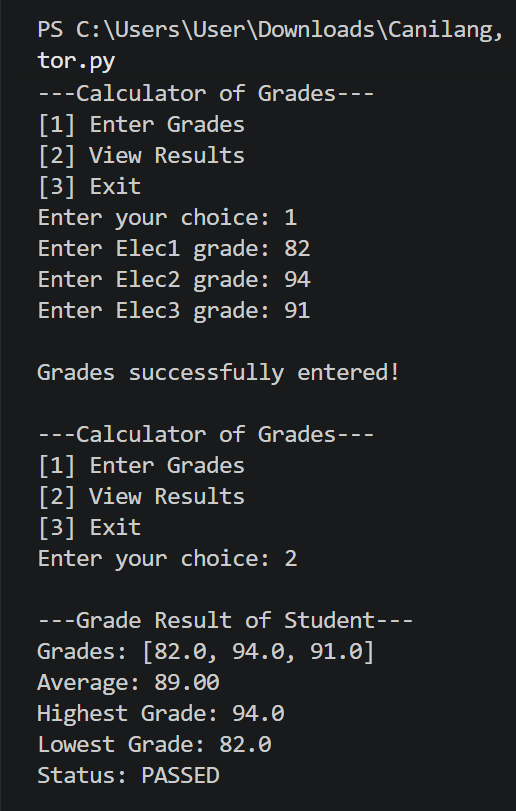
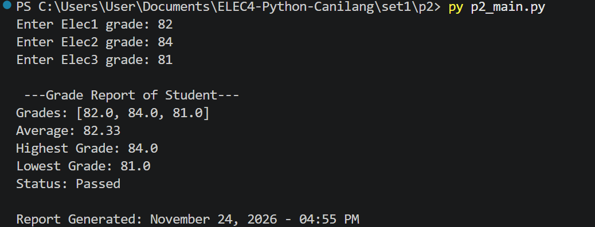
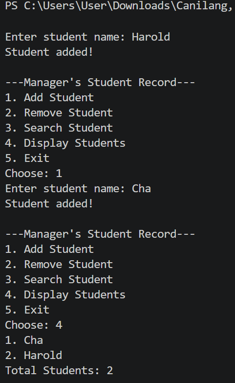
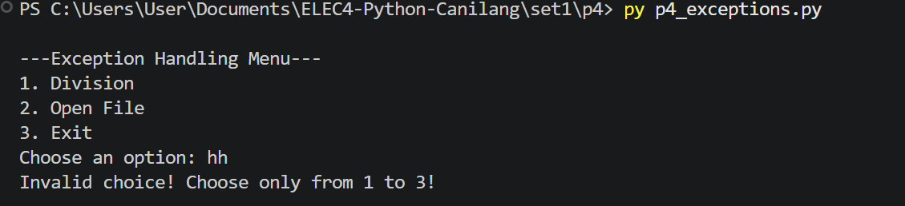

# ELEC 4 – Python Programming

**Name:** Harold Canilang
**Section:** IV-BSIT-A
**Course:** ELEC 4 – Python Programming
**Instructor:** Carl Gustaf Patrik B. Ferrer

This repository contains my outputs for the ELEC 4 – Python Programming Self-Paced Learning Assignment.

## Activities

### Set 1

| Activity | Description | Folder |
|---|---|---|
| P1 | Student Grade Calculator: menu-driven program built from user-defined functions | [set1/p1](set1/p1) |
| P2 | Custom module `student_utils` imported by `p2_main.py` | [set1/p2](set1/p2) |
| P3 | Student Record Manager using lists and sets | [set1/p3](set1/p3) |
| P4 | Safe Menu Program using try/except/else/finally | [set1/p4](set1/p4) |

## How to Run

Run each command from the root of this repository.

| Activity | Command |
|---|---|
| P1 | `python set1/p1/p1_grade_calculator.py` |
| P2 | `python set1/p2/p2_main.py` |
| P3 | `python set1/p3/p3_record_manager.py` |
| P4 | `cd set1/p4` then `python p4_exceptions.py` |

## Screenshots

### P1

### P2

### P3

### P4

